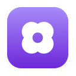

<p align="center">
  
</p>

# BetterShot for Linux

A port of BetterShot to Linux in Rust, with GTK 4 and libadwaita. The port
lives in [`linux/`](linux/). The macOS app it ports is in this repository too:
its Swift sources in `Sources/` remain the reference implementation, and
[README.macos.md](README.macos.md) describes it. The
[port plan](docs/linux-port-plan.md) describes the stack, phases, and
Wayland constraints.

**Status:** every phase of the port plan is delivered: screenshots, the
image editor, capture extras, sharing, the library, screen recording, the
video studio with 3D shots, the teleprompter, optional whisper.cpp
subtitles, and packaging. Capture an area, the screen, a window,
the previous area, or a scrolling area; copy, save, drag, pin, share, or edit
captures from the capture deck; annotate and frame them in the editor, with
smart redaction of sensitive text; copy text from the screen with OCR; pick
colors; share links through your own Cloudflare R2 bucket; browse everything
in the Media Gallery; record a display, window, or area with audio, a camera,
and a teleprompter; and cut, frame, zoom, mask, restyle the cursor, caption,
reframe, fly a 3D camera around, and export recordings in the studio.

Everything so far was verified headless (`make check` and `make check-ui`
under Xvfb with a fixture screen). Real portals, PipeWire, PulseAudio,
cameras, the tray, Wayland window placement, and audio output have not been
exercised on a desktop yet, so reports from real machines are the most
useful thing you can contribute: see [Reporting what you find](#reporting-what-you-find).

[Build from source](#build-from-source) · [Install](#install) · [GNOME Shell helper](#gnome-shell-helper) ·
[Packages](#packages) · [Verify](#verify-a-build) · [Using it](#using-it) ·
[Known limitations](#known-limitations) · [Layout](#layout) · [Development](#development)

## Build from source

### 1. Check the requirements

| Need | Minimum | Why |
| --- | --- | --- |
| Rust | 1.92 | `rust-version` in `Cargo.toml`; the build refuses older compilers |
| GTK 4 | 4.14 | The `gtk4` crate is built with its `v4_14` feature |
| libadwaita | 1.5 | Adaptive dialogs, toolbar views, and the preferences window |
| GStreamer | 1.20 | Recording, the studio preview, and video export |
| xdg-desktop-portal with a desktop backend | any | Screenshots, screen recording, global shortcuts, and the color picker |

Ubuntu 24.04, Debian 13, Fedora 40, Arch, and anything newer ship recent
enough GTK and libadwaita. Distribution Rust packages are often older than
1.92, so install the toolchain with [rustup](https://rustup.rs) unless
`rustc --version` already reports 1.92 or later:

```bash
curl --proto '=https' --tlsv1.2 -sSf https://sh.rustup.rs | sh
```

Open a new shell afterwards (or `source ~/.cargo/env`) so `cargo` is on your
PATH. `make check` also needs the `rustfmt` and `clippy` components, which
rustup installs with the default profile.

### 2. Install the libraries and runtime tools

The build links GTK 4, libadwaita, and GStreamer through `pkg-config`. At run
time BetterShot talks to your desktop through the portals and to GStreamer's
plugins; the recorder picks the first H.264 encoder it finds (`x264enc`,
`vaapih264enc`, or `openh264enc`) and the first AAC or Opus encoder. Install
all of them in one go.

**Ubuntu / Debian** (tested package names from `cargo-deb`'s dependency list
and CI):

```bash
sudo apt install build-essential pkg-config \
  libgtk-4-dev libadwaita-1-dev \
  libgstreamer1.0-dev libgstreamer-plugins-base1.0-dev \
  gstreamer1.0-pipewire gstreamer1.0-x gstreamer1.0-plugins-good \
  gstreamer1.0-plugins-bad gstreamer1.0-plugins-ugly gstreamer1.0-libav \
  gstreamer1.0-pulseaudio \
  xdg-desktop-portal tesseract-ocr tesseract-ocr-eng
```

Then the portal backend for your desktop, if it is not already installed:
`xdg-desktop-portal-gnome` on GNOME and Ubuntu, `xdg-desktop-portal-kde` on
KDE Plasma, or `xdg-desktop-portal-wlr` on Sway, Hyprland, and other
wlroots compositors.

**Fedora:**

```bash
sudo dnf install gcc pkgconf-pkg-config \
  gtk4-devel libadwaita-devel \
  gstreamer1-devel gstreamer1-plugins-base-devel \
  pipewire-gstreamer gstreamer1-plugins-good gstreamer1-plugins-bad-free \
  gstreamer1-plugin-openh264 \
  xdg-desktop-portal tesseract tesseract-langpack-eng
```

**Arch:**

```bash
sudo pacman -S --needed base-devel pkgconf \
  gtk4 libadwaita \
  gstreamer gst-plugins-base gst-plugins-good gst-plugins-bad \
  gst-plugins-ugly gst-libav gst-plugin-pipewire \
  xdg-desktop-portal tesseract tesseract-data-eng
```

Optional extras, on any distribution:

- `gstreamer1.0-vaapi` (Debian) or `gstreamer1-vaapi` (Fedora) for hardware
  H.264 encoding on Intel and AMD GPUs; without it x264 encodes on the CPU.
- `zbar-tools` (`zbar` on Fedora and Arch) so Capture Text also reads QR
  codes and barcodes.
- A Secret Service provider for cloud sharing's keys: GNOME Keyring, KWallet,
  or KeePassXC. Desktops run one already.
- `grim` on wlroots compositors whose portal lacks the Screenshot interface.
- [whisper.cpp](https://github.com/ggml-org/whisper.cpp) for narration
  subtitles: build it so `whisper-cli` is on your PATH, download a
  `ggml-*.bin` model, and pick the model in Settings › Recording. BetterShot
  also looks for models in `~/.local/share/whisper.cpp/models`,
  `~/.cache/whisper.cpp`, and `/usr/share/whisper.cpp/models`.

### 3. Get the source

```bash
git clone https://github.com/BoredYama/better-shot-linux.git
cd better-shot-linux/linux
```

Every command below runs from `linux/`, or from the repository root as
`make -C linux <target>`. `make help` lists the targets.

### 4. Build

```bash
make release
```

This runs `cargo build --workspace --release` and leaves the program at
`target/release/bettershot`. The first build compiles the GTK, GStreamer, and
zbus bindings and takes several minutes; later builds are incremental.
`make build` makes a Debug build at `target/debug/bettershot` instead, which
compiles faster but renders 3D shots and video exports much more slowly.

### 5. Run it

To try a build without installing it:

```bash
./target/release/bettershot
```

That opens Settings and keeps BetterShot running in the background with its
tray icon, global shortcuts, and real storage under `~/.config/bettershot`
and `~/.local/share/bettershot`. `./target/release/bettershot capture region`
and the other commands under [Using it](#using-it) talk to that instance.

`make run` starts a Debug build with `BETTERSHOT_TESTING=1` and an isolated
profile under `target/dev-profile`, so experiments never touch your real
library, settings, or keyring.

Global shortcuts and the dock menu need the desktop entry, so install the
build (next section) before testing those.

## Install

```bash
make install            # into /usr/local
sudo make install       # if /usr/local is not writable by you
make install PREFIX=~/.local
```

`make install` builds the release binary if needed, then installs the
program, the desktop entry, the AppStream metadata, the clover icons, the
onboarding image, the license notices, and the GNOME Shell helper extension
under `PREFIX`, and refreshes the icon and desktop caches. BetterShot then appears in your app menu, and
`bettershot --help` lists every command. `make uninstall` (with the same
`PREFIX`) removes it all; packagers set `DESTDIR` to stage into a directory
instead.

## GNOME Shell helper

On GNOME, the BetterShot Helper extension makes captures behave as they do on
macOS. Wayland keeps every app away from the screen, the window list, and the
pointer, so without it captures go through the screenshot portal, which
flashes the screen and asks once whether to allow screenshots. The helper runs
inside GNOME Shell itself, where those limits don't apply, and gives
BetterShot four things:

- **Silent captures of every screen**, with no flash, no permission question,
  and no screen-sharing dialog.
- **A window picker on a still frame.** Capture Window dims the screen,
  highlights the window under the pointer, and captures that window's own
  pixels even where other windows cover it, cropped to its frame as macOS
  does. Tab moves through the windows and Enter captures.
- **The pointer during recordings**, so Wayland recordings hide the system
  cursor and the studio can restyle it and add click effects, as on X11.
- Window titles and positions for the picker, which plain Wayland apps never
  see.

`make install` and the Debian package install it with BetterShot. GNOME Shell
only finds new extensions when it starts, so log out and back in once, then
choose Turn On in Settings › Capture, or run:

```bash
gnome-extensions enable bettershot-helper@bettershot.site
```

Only the BetterShot program installed in `/usr/bin` or `/usr/local/bin` can
use it. Each call compares the file the calling process runs with those
installed files, so another app cannot pose as BetterShot, and the helper
only writes inside your runtime folder. A development build, the AppImage, or
the Flatpak runs from elsewhere, so the helper ignores it and captures use the
portal as before; Settings says so. The helper is off on the lock screen, like
every GNOME extension. It supports GNOME 45 to 50; `make check-gnome-helper`
tests it against a real, headless GNOME Shell.

## Packages

All three packages depend on your distribution's GTK, GStreamer, portals,
and Tesseract; none of them bundle those.

**Debian package.** Needs `cargo install cargo-deb` once.

```bash
make deb
sudo apt install ./target/debian/bettershot_*.deb
```

The package declares its runtime dependencies, so apt installs the GStreamer
plugins and portal it needs and recommends PipeWire, the extra codecs,
PulseAudio, and Tesseract.

**AppImage.** Needs [appimagetool](https://github.com/AppImage/appimagetool/releases)
on your PATH, or `APPIMAGETOOL` pointing at it.

```bash
make appimage
```

The AppImage lands in `target/appimage/`. Without appimagetool the script
still assembles `target/appimage/BetterShot.AppDir` for inspection.

**Flatpak.** Needs `flatpak-builder`, the GNOME 48 runtime and SDK, and the
Rust SDK extension:

```bash
flatpak install flathub org.gnome.Platform//48 org.gnome.Sdk//48 \
  org.freedesktop.Sdk.Extension.rust-stable//24.08
make flatpak
```

`make flatpak` builds from `packaging/flatpak/site.bettershot.BetterShot.yml`
and installs the result for your user. The manifest builds offline from
`packaging/flatpak/cargo-sources.json`; regenerate that file with
[flatpak-builder-tools](https://github.com/flatpak/flatpak-builder-tools)'
`flatpak-cargo-generator.py Cargo.lock -o packaging/flatpak/cargo-sources.json`
whenever `Cargo.lock` changes. The Flatpak takes H.264 from the runtime's
OpenH264 extension and cannot reach a host Tesseract, so Capture Text and
smart redaction are unavailable there until Tesseract is bundled, and
cameras will need the Camera portal.

## Verify a build

```bash
make check        # fmt, clippy with warnings as errors, and tests (what CI runs)
```

`make check` runs `cargo fmt --check`, `cargo clippy` on every target with
warnings as errors, and the whole workspace's tests with
`BETTERSHOT_TESTING=1`, which keeps every file in a temporary folder and
substitutes fixture keys for the keyring. The tests rewrite macOS fixtures
to prove the file formats stay byte-compatible, port the 3D camera against
Cap's reference data, and drive the GStreamer recorder and exporter with a
fake screen, so they need the GStreamer plugins above but no display, portal,
or hardware.

```bash
make check-ui     # drive the real app under Xvfb with a fixture screen
```

`make check-ui` needs these on top of the build dependencies. On Ubuntu and
Debian:

```bash
sudo apt install xvfb openbox xdotool xclip imagemagick python3-pil dbus \
  desktop-file-utils appstream fonts-dejavu-core gstreamer1.0-plugins-base-apps
```

It starts an X server, Openbox, and a session bus, replaces the portal with
fixture images, runs a fake R2 bucket on 127.0.0.1 with fixture keys, and
clicks through every feature in light and dark appearances: region capture
with automatic saving on and off, Escape, the card's Save button with
Settings open, Capture Previous Region, Hide After, the editor (shapes,
text, a gradient background, Save, rotating, the unsaved-changes prompt,
reopening, and crop), Capture Text, Pick Color, smart redaction, Capture
Region & Pin, a scrolling capture, sharing from a card and from the editor,
the Sharing settings, the Media Gallery, first-run setup, What's New,
recording (the bar, an area recording with Pause, the card and automatic MP4
saving, Discard's confirmation, recovery of an interrupted package, and the
X11 pointer timeline), the teleprompter, and the studio (cuts, backgrounds,
undo, playback, cursor styles, crop and mask handles, reframing, captions,
3D shots, Save, and reopening). `BETTERSHOT_UI_ONLY=text,scroll` runs only
the named scenarios (`autosave`, `manual`, `editor`, `crop`, `hide`, `text`,
`onboarding`, `whatsnew`, `share`, `pin`, `scroll`, `color`, `denied`, `redact`,
`studio`, `record`, `handles`, `reframe`, `captions`, `teleprompter`,
`shots3d`, `cursor`). Each step's screenshot lands in `target/ui-snapshots/`.
The whole suite takes a long while; the `shots3d` scenario alone renders a
3D export on the CPU for a few minutes.

The headless run cannot check real portals, Wayland compositors, PipeWire,
audio devices, cameras, global shortcuts, the tray, or window placement.
Those need a desktop.

### Reporting what you find

Start BetterShot from a terminal so its messages are visible, then try the
feature on your desktop:

```bash
bettershot
```

A useful report names the distribution and desktop (GNOME or KDE, Wayland or
X11), the action or command, what you expected, what happened, and the
terminal output. The areas no one has run on real hardware yet are
screenshots and the color picker through the portal; recording through the
ScreenCast portal (the picker, PipeWire frames, system audio from the
PulseAudio monitor, the microphone, and a camera); the studio preview's
sound, VA-API exports, and 3D-shot export speed; the tray icon, global
shortcuts, and where Wayland places the capture bar, the deck, and pins;
cloud sharing with a real R2 bucket and keyring; and whisper.cpp with a real
model.

### Troubleshooting

- **`cannot be built because it requires rustc 1.92 or newer`:** your
  distribution's Rust is too old. Install rustup's stable toolchain and make sure `~/.cargo/bin` comes
  first on your PATH.
- **`The system library 'gtk4' required by crate 'gdk4-sys' was not found`**
  or the same for `libadwaita-1` or `gstreamer-1.0`: a `-dev`/`-devel`
  package or `pkg-config` is missing. Install the list for your distribution
  above.
- **"No screenshot service is available":** install `xdg-desktop-portal`
  and the backend for your desktop, then log out and in, or on wlroots
  install `grim`.
- **"No H.264 encoder is installed":** install `gstreamer1.0-plugins-ugly`
  (x264), `gstreamer1.0-vaapi`, or the OpenH264 plugin.
- **Recording fails on an X11 session without a ScreenCast portal:** the
  fallback is GStreamer's `ximagesrc`, in `gstreamer1.0-x` on Debian.
- **No tray icon on GNOME:** GNOME shows tray icons only through the
  AppIndicator extension. Ubuntu ships it as Ubuntu AppIndicators; turn it
  on in the Extensions app, or check it with the command below. Settings ›
  General › Show tray icon says when no tray host is running, and the icon
  appears as soon as one starts, without restarting BetterShot.

  ```bash
  gnome-extensions list --enabled | grep -i appindicator
  ```
- **No notifications on GNOME** (errors, "No text found"): GNOME shows an
  app's notifications only when its desktop entry is installed, so run
  `make install` (or install a package) rather than the binary from
  `target/`.
- **"Screenshots Are Blocked", or captures fail while window capture
  works:** your desktop remembers a Deny for BetterShot's screenshots
  (closing its "Allow screenshots?" question also counts as Deny), and then
  refuses every capture without asking. Choose Ask Again in BetterShot's
  dialog, or Allow in setup, and pick Allow when the desktop asks. Window
  capture is unaffected because it always shows the desktop's own dialog.
- **The screen flashes on GNOME:** GNOME's screenshot portal flashes for
  each shot. Turn on Settings › Capture › Read the screen through screen
  sharing for silent captures, and select every screen when the desktop
  asks which to share.
- **Global shortcuts do nothing:** the GlobalShortcuts portal needs GNOME
  48, Plasma 6, or Hyprland; elsewhere bind the commands in Settings ›
  Shortcuts through your desktop's keyboard settings.

## Using it

| Command | What it does |
| --- | --- |
| `bettershot` | Open Settings (BetterShot keeps running in the background) |
| `bettershot capture region` | Select an area from a still frame of the screen |
| `bettershot capture fullscreen` | Capture the screen; with several monitors, pick one |
| `bettershot capture window` | Choose a window in your desktop's screenshot dialog |
| `bettershot capture previous-region` | Capture the last selected area again |
| `bettershot capture timed-region` | Select an area after a countdown |
| `bettershot capture region-copy` / `region-save` / `region-pin` | Select an area, then only copy, save, or pin it |
| `bettershot capture scroll` | Capture an area while you scroll it; run it again to finish |
| `bettershot capture text` | Select an area and copy its text (`text-single-line` joins the lines) |
| `bettershot capture color` | Pick a color on screen and copy its hex value |
| `bettershot record` | Open the capture bar, with the recording sources and input toggles |
| `bettershot record display` / `window` / `area` | Start recording; `area` selects it first |
| `bettershot record stop` / `pause` / `restart` / `discard` | Control the running recording (`restart` and `discard` ask first) |
| `bettershot edit FILE` | Open an image in the editor, or a recording project (`.bettershotrec`) in the studio |
| `bettershot open-image` | Choose an image to edit |
| `bettershot gallery` | Open the Media Gallery |
| `bettershot bettershot://capture/region` | Run a BetterShot URL (also `capture/scroll`, `record`, `ocr`, `color-picker`) |
| `bettershot quit` | Quit the running instance |

Right-clicking BetterShot in a dock or app grid offers the same captures.

**In the selector**, drag to select an area. Drag its edges or corners to
resize it, or drag inside it to move it. Press Enter or double-click to
capture, or Escape to cancel. The selector opens with your last area selected,
so Enter captures it again.

**Capture Screen** with several monitors shows a still frame of every screen
and highlights the one under the pointer, with its name and size. Click it,
or move through the screens with Tab and press Enter; Escape cancels. With one
monitor it captures that screen at once.

**On a capture card**, Copy puts both the image and a file on the clipboard,
Save writes it to your save folder, Edit opens the editor, Pin keeps it on
screen, and Dismiss closes it. Drag the card into another app to hand over the
file, or double-click it to edit. Cards stay until you choose Dismiss or press
Escape while the deck is active; Settings › Capture Deck › Hide after can hide
them after a delay instead. The deck holds up to five cards, as on macOS,
dropping the oldest one that isn't uploading, and scrolls when the cards are
taller than the screen. Cards are Extra Large by default, 1.5 times the
macOS app's largest size; Card size also offers Small, Medium, and Large.

**In the editor**, the toolbar has Select, Rectangle, Solid rectangle, Circle,
Line, Arrow, Freehand, Numbered circle, Text, Highlight (dims everything outside
the areas you draw), Pixelate, and Blur, then Crop, Rotate, and Flip. Clicking
the active tool again returns to Select. The inspector on the left sets the
style of the tool or selection, and the background: gradients, colors, or an
image, with padding, corners, shadow, aspect ratio, position, border, and a
watermark. New captures start with the look from General > Default Look.

- **Save** (Ctrl+S) keeps your edits editable and creates or replaces the
  capture's file in your save folder, even if you changed nothing.
- **Copy** (Ctrl+Shift+C) copies the edited image without changing that file.
- **Export As** writes a new PNG or JPEG anywhere.
- Closing with unsaved changes asks to Save, Discard, or Cancel.

Tool keys follow macOS: H select, R rectangle, O circle, L line, A arrow,
1 numbered circle, T text, P pixelate, B blur, C crop. Ctrl+Z and Ctrl+Shift+Z
undo and redo, Delete or Backspace removes the selection, arrow keys nudge it,
and Ctrl+= / Ctrl+- / Ctrl+1 / Ctrl+0 zoom. Hold Shift while drawing to keep a
square or snap a line to 45°. Double-click text to edit it.

**Smart Redaction** (the eye button after the tools) finds email addresses,
links, IP addresses, phone and card numbers, tokens, and labeled secrets such
as `password: …` with Tesseract, and covers each with Pixelate or Blur in one
undoable step. Check the result: recognition can miss text.

Edits are stored beside the capture in the library as a `.bettershot` sidecar
in the macOS app's format, so they reopen editable; the capture's own pixels
are never changed.

**Saving:** captures stay private until you save them. New installs save
region, screen, and window screenshots to `Pictures/Screenshots`
automatically. Turn this off, or change the folder and format, in
Settings > General.

**Sharing** uploads a capture to your own Cloudflare R2 bucket and copies a
link. Set it up in Settings › Sharing: Account ID, Jurisdiction, the API
token's Access Key ID and Secret Access Key, Bucket, and the bucket's public
address; Test Connection checks them and turns on Upload when I share. Then
Share (the cloud button) on a capture card or in the editor compresses the
image, uploads it with a poster and a manifest, and copies a link to a viewer
page on bettershot.site, or with Copy direct file links, to the file itself.
Progress, the link, and failures with Retry show on the card or at the top of
the editor. The link is saved with the capture, and the same bucket and links
work with the macOS app. Keys go to your login keyring, never a file.

**The Media Gallery** (`bettershot gallery`, or Media Gallery in the tray)
lists captures On this Computer and Cloud Shares, as icons or a list, with
search and sorting. Double-click opens a capture as a card; its menu (or a
right-click) offers Open, Edit, Show in Files, Copy Link, Open Cloud Link, and
Move to Trash or Delete Cloud Share, each asking first. A shared capture moved
to the trash stays under Cloud Shares until you delete the share.

**First run** opens a four-step setup: Welcome; a check of screenshot access
and global shortcuts; where screenshots go and whether they save
automatically; and a practice capture. It resumes where you left off and never
returns once skipped or done; Settings › About › Take the Tour reopens it.
After an update, What's New shows that release's notes from
[CHANGELOG.md](linux/CHANGELOG.md) once; About reopens them, or before the first
Linux release, the Unreleased changes.

**Pinned screenshots** float as borderless windows. Drag one to move it,
scroll over it to scale it (a quarter to four times), hover for its close
button, or right-click to copy or close it. Ctrl+C copies and Ctrl+W closes.

**Capture Text** shows the still frame; drag over text and BetterShot copies
it when you release. If no text is found, the clipboard keeps what it had.
**Pick Color** uses your desktop's color picker, or a magnifier over a still
frame where the desktop has none; click a pixel to copy its `#RRGGBB` value.
Both end with a small Copied window showing what was copied; on Wayland that
window is also what lets BetterShot write the clipboard, so if your desktop
leaves it unfocused, click its Copy button.

**Still frames** behind region, scrolling, text, and color captures cover
every screen with no selection step. On an X11 session they are read
directly from the X server (silent, no dialog). On GNOME with the
[BetterShot Helper](#gnome-shell-helper) turned on, the helper reads them
silently. Otherwise, on Wayland they come from
the screenshot portal, which captures the whole desktop at once; GNOME
flashes the screen for each shot and, the first time, asks whether to allow
BetterShot to take screenshots, so choose Allow. Settings › Capture › Read
the screen through screen sharing makes captures silent instead, at the
cost of the desktop asking which screens to share (select every screen);
it is off by default.

**Scrolling Capture** selects an area from a still frame, then opens a small
session window. Scroll the content, choose **Add Frame** (or press Enter), and
repeat; each frame must overlap the previous one. **Done** adds a last frame
and puts the stitched image on a capture card, like any capture; Escape or
Cancel discards it. A pinned header, such as a toolbar, appears once, and a
frame that doesn't overlap is skipped, so scroll back a little and add it
again.

**Screen recording** starts from the capture bar (Super+Shift+2, the tray's
Record Screen…, or `bettershot record`). Its picker row offers the screenshot
modes, then Display, Window, and Area, then Camera, Mic, and Audio toggles, a
Script button, and a Timer. Display and Window open your desktop's
screen-sharing dialog to pick the source; the display you chose is kept
across launches, so later display and area recordings skip the dialog,
while a window is chosen each time. Area selects an area from a still frame
and records that part of its display.
While recording, the bar becomes a row with Stop and the elapsed time,
Pause/Resume, Start Over, and Discard; the last two ask first. Stop puts a
card with the recording's first frame and length on screen: Save writes an
MP4 to your save folder and replaces it on later saves, Copy puts the file on
the clipboard, Open plays it, and Delete removes the project. Settings ›
Recording sets a countdown, the frame rate, automatic saving, system audio,
the microphone, the camera, and the whisper.cpp model. Recordings are kept as
projects in `~/.local/share/bettershot/Recordings` in the macOS app's package
format, listed in the Media Gallery, and written so that a crash leaves them
playable; the next launch recovers interrupted ones.

**Teleprompter.** The capture bar's Script button opens a small window: paste
or type what you want to say, turn on Show while recording, and choose how
many lines show. While a recording runs, the prompter hangs near the top of
the screen; scroll it a line at a time with the mouse wheel, the arrow or
Page keys, or its arrow buttons. macOS follows your voice; Linux has no
speech engine, so the prompter moves only when you scroll it.

**The video studio** opens from a recording card's Edit button (or a
double-click), the Media Gallery's Edit, `bettershot edit <project>`, or
automatically after recording with Settings › General › Open the editor. The
inspector on the left has Background (the gradients and colors, padding,
corner radius, and shadow; new recordings start from General › Default Look;
the Presets menu applies, saves, and deletes named looks),
Cursor (on recordings made in an X11 session: show, Recorded, Arrow, Dark,
Light, or Dot styles, size, smooth motion, click effects with press and
ripple, and hiding when idle; Wayland recordings keep the cursor in the
picture), Camera (show, the
Bubble, Overlap, Side-by-Side, Presenter, Camera Only, and Screen Only
layouts, side, size, roundness, and frame ratio; in the Bubble layout, drag
the bubble on the preview), Effects (Adjust Crop shows the whole recording
with handles to drag, Return applies and Escape cancels; blur or pixelate
masks, each with an area you drag by its handles on the preview, a strength,
and a time range; keystroke captions for the shortcuts recorded on X11, with
their placement; and the subtitle bar for projects that carry cues from the
macOS app's transcription or from Transcribe, which runs whisper.cpp on the
narration when the `whisper-cli` command and a model chosen in Settings ›
Recording are installed, with its position, text size, and spoken-word
highlight; and 3D Shots: Add Shot places a three-second shot at the playhead
with one of Cap's thirteen camera moves, Auto Scene lays out Cap's
automatic sequence, and each shot has its move, start, end, transition,
easing, Reverse, and a depth blur with radial, directional, or tilt-shift
focus, falloff, and bokeh; D adds a shot, C adjusts the crop, B and P add
masks), Zoom & Clips
(zooms at the playhead with magnification, focus, and how they follow;
Scissors, Delete Clip, Reset Clips, and the selected clip's speed), and Export
(the aspect ratio, from the original to 16:9, 16:10, 4:3, 9:16, 1:1, and 4:5,
with Fill cropping into the recording along a camera that follows your
cursor and zooms, or Fit framing the whole recording on the background; MP4
or MOV, 30 or 60 fps, quality, resolution, audio). A crop sets the output
size, as on macOS. Exports blur the picture while a zoom or reframe camera
moves, sampling the frame up to 4, 12, or 24 times at the Fast, Medium, and
Slow encoder speeds. The preview draws
exactly what exports do; Space plays it with the recording's sound, Left and Right step
a frame, and Shift steps a second. On the timeline, click to seek and select
a clip, click with Scissors (S) to cut, and read the removed time under each
cut. Ctrl+Z and Ctrl+Shift+Z undo and redo; drafts save as you work, and
closing with unsaved edits asks. **Save** (Ctrl+S) writes the project,
renders the edited video into it, and creates or replaces the saved file in
your folder; **Export As** writes a new file anywhere. Projects are the macOS
app's `.bettershotrec` packages and `edit.json`, so they open on either
platform.

### Keyboard shortcuts

BetterShot asks your desktop for global shortcuts through the GlobalShortcuts
portal (GNOME 48+, KDE Plasma 6, Hyprland). The defaults mirror macOS with
Super in place of ⌘: Super+Shift+4 for a region, Super+Shift+3 for the screen,
Super+Shift+1 for the previous region. Your desktop may ask you to confirm or
change them.

Where the portal is unavailable, Settings > Shortcuts lists a command for each
action. Add a custom shortcut in your system's keyboard settings that runs it,
for example `bettershot capture region`.

### Known limitations

- **Upload progress** advances per file (the capture, its poster, and the
  manifest) rather than continuously, because R2 needs each file's size up
  front. Recordings cannot be shared yet.
- **The capture bar appears in display recordings.** Wayland cannot keep an
  app's own windows out of a screen share, so move the bar off the recorded
  area, record a window, or stop with the tray or a shortcut.
- **On Wayland the cursor is recorded as pixels**, unless the
  [BetterShot Helper](#gnome-shell-helper) is on. GStreamer's PipeWire
  source drops the stream's cursor metadata and Wayland exposes no global
  pointer, so those recordings have no separate pointer timeline and the
  studio cannot restyle or hide the cursor or add click effects. X11
  sessions, and GNOME with the helper, hide the system cursor and record the
  pointer and its buttons into `input.json` instead; a card's Save then
  renders the recording with the default look, as macOS does. Keyboard
  captions need X11: the helper does not read the keyboard. Window
  recordings keep the cursor in the picture, because the portal does not
  report a window's position.
- **The studio preview plays by stepping frames** without motion blur; the
  blur is in the exported file. Transcription needs whisper.cpp installed
  separately and runs on the CPU, and there is no subtitle editor yet.
- **3D shots render on the CPU.** The perspective warp and depth blur run
  on every core without a GPU, so the preview shows them at half
  resolution and an export with shots takes a few times longer than one
  without. Keyframe tracks and the orbit pad from macOS projects play back
  but are edited with the sliders only.
- **Area recordings** are cropped from the display your desktop's dialog
  shares. Pick the display that holds the area; if it does not, the whole
  display is recorded.
- **Cameras** are read through V4L2, which a Flatpak build will need the
  Camera portal for.
- **Scrolling capture is manual.** macOS adds frames on its own as you scroll
  and auto-scrolls. Wayland gives apps neither scroll events from other apps
  nor a way to keep their own windows out of screenshots, so you choose Add
  Frame after each scroll. Auto Scroll is not available. With screen sharing
  off on GNOME, every frame flashes the screen once.
- **Window captures use your desktop's screenshot dialog** without the
  [BetterShot Helper](#gnome-shell-helper). Wayland reports no window
  positions to apps, so there is no way to pick a window on a still frame as
  macOS does; the dialog (GNOME's screenshot UI, KDE's Spectacle picker) is
  the only route. The helper is GNOME-only.
- **Pins don't stay on top by themselves.** Wayland doesn't let apps keep
  windows above others; use your desktop's Always on Top (Alt+Space or
  Super+Space opens the window menu on GNOME and KDE).
- **OCR quality** depends on Tesseract and the installed language packs. It
  reads English by default and does best on clear, unscaled screen text.
- **Window placement.** Wayland does not let apps position their own windows,
  so the capture deck opens wherever your desktop places it. Drag it by its
  background to move it.
- **Tray icon.** It uses StatusNotifierItem. KDE, Cinnamon, XFCE, and most
  wlroots bars show it; GNOME needs the AppIndicator extension. GNOME's
  extension cannot right-align shortcuts, so its menu shows each one after
  a dot (`Capture Region · Super+Shift+4`); other hosts draw them in their
  own accelerator column.
- **Default Look on captures.** The editor starts new images with your Default
  Look, but cards and automatic saves still show the plain capture.
- **Editor gaps.** There is no rotation handle for individual shapes, arrows
  are not bound to shapes when drawn on Linux, curved arrows have no bend
  handle, and editor shortcuts cannot be changed yet. Documents from macOS that
  use these still open and render correctly.
- **macOS-only effects.** The 3D camera and progressive blur are kept when you
  save a macOS document on Linux, but not shown.
- **Fonts.** SF Pro, SF Compact, and SF Rounded become Inter or Cantarell, a
  condensed sans, and Nunito or Comfortaa, falling back to your default sans.
- **Multiple monitors with different scale factors** may select slightly off,
  because the portal returns one image for the whole desktop.

## Layout

| Crate | Contents |
| --- | --- |
| [`bettershot-core`](linux/crates/bettershot-core) | Models, file formats, and logic with no GUI dependencies |
| [`bettershot-render`](linux/crates/bettershot-render) | The shared cairo/Pango renderer used by the editor canvas, every image export, and the studio's preview and video export |
| [`bettershot-platform`](linux/crates/bettershot-platform) | Screenshot, ScreenCast, and GlobalShortcuts portals, silent still frames from a ScreenCast stream, the GNOME Shell helper client, the GStreamer recorder, X11 pointer sampling, frame and audio readers, the video exporter, whisper.cpp, media helpers, device lists, `grim` fallback, tray, the R2 HTTP client, and keyring storage |
| [`bettershot-app`](linux/crates/bettershot-app) | The GTK app and `bettershot` command |
| [`gnome-extension`](linux/gnome-extension) | The BetterShot Helper GNOME Shell extension (JavaScript, GNOME 45 to 50) |

### What `bettershot-core` covers

Each module names the Swift file it ports. Keep the two in step.

| Module | Ports |
| --- | --- |
| `annotation` | `Shape.swift`, `AnnotationDocument.swift`, `AnnotationBackground*.swift`, `AnnotationImageTransform.swift`: shapes, the `.bettershot` sidecar, background layout, crop/rotate/flip |
| `gallery`, `transfer` | `MediaGallery.swift` and `MediaGalleryActions.swift` (items, filters, sorting, deletion); the `TransferStatusCard` model |
| `text_recognition` | `ImageTextRecognizer.swift`, `SmartRedactionRecognizer.swift`, and `ColorPickerOverlay.hexFromColor`: Tesseract output, sensitive-text rules, hex colors |
| `scroll_capture` | `ScrollFrameAnalyzer.swift` and `ScrollCaptureController`'s registration and merge rules (adapted from MacShot, GPLv3) |
| `pin` | `PinnedScreenshot.swift`: pin size and scroll-scaling |
| `recording` | `RecordingSession.swift`, `RecordingProject.swift`, `RecordingDeliverable.swift`, `RecordingRecoveryCoordinator.swift`, and `ScreenRecordingManager`'s state and clock: the package, its sidecars, deliverable naming and saving, recovery |
| `recording::edit`, `clips`, `viewport`, `layout` | `RecordingStudioStyle.swift` (the format 8 edit document, style, and canvas layout), `RecordingClipTimeline.swift`, `RecordingViewportTimeline.swift` and `RecordingMotionSpring.swift` (zoom cues and springs, adapted from Cap), `RecordingVideoMask.swift`, `RecordingVideoCrop.swift`, `VideoCompressionModels.swift` |
| `recording::pointer`, `reframe`, `captions`, `shots3d`, `style_presets`, `transcription` | `RecordingPointerStream.swift`, `RecordingPointerTimeline.swift`, and the click feedback and keystroke captions in `RecordingOverlayEffects.swift`; `RecordingExportReframe.swift`; the subtitle bar in `RecordingTranscription.swift`; `Recording3DShot.swift` (adapted from Cap, AGPLv3); `RecordingStudioStylePresetStore.swift`; `RecordingTranscription.swift`'s cue chunking with a whisper.cpp parser |
| `teleprompter` | `TeleprompterScript.swift`: display words, the script matcher, and line layout |
| `deck` | `DeckStaging.swift`, `ScreenshotFileActions`, and `CaptureOrchestrator`'s staging and after-capture decisions |
| `history` | `HistoryStore.swift`: the library, `history.json`, and retention |
| `imaging` | `FrozenScreenFrame.swift`, image encoding, and atomic, collision-free writes |
| `after_capture`, `app_prefs` | `AfterCaptureActions.swift` and `AppPreferences.swift` |
| `file_naming` | `ScreenshotFileNaming.swift`: templates, tokens, sanitizing, collision-free paths |
| `url_action` | `CaptureURLAction.swift`: `bettershot://` routes |
| `region` | `RegionGeometry.swift`: selector handles and drag math |
| `overlay_layout` | `OverlayLayout.swift`: capture card action slots |
| `shortcuts` | `ShortcutCatalog.swift` and `ShortcutService.swift` persistence/validation |
| `release_notes`, `onboarding` | `ReleaseNotes.swift`, `OnboardingState.swift` |
| `background` | `BackgroundStyle.swift`, color grades, `BeautifierConfig` |
| `capture_record` | `CaptureRecord.swift` (`history.json` entries) |
| `share`, `r2` | `ShareManifest.swift`, `ShareImageCompressor.swift`, and `R2Uploader.swift`'s signing: manifests, posters, upload compression, links, SigV4 requests |
| `prefs`, `paths`, `version` | `UserDefaults` stand-in, XDG directories, `version.json` |

Files shared with the macOS app (history, Default Look, editor sidecars, share
manifests, recording packages) use the same JSON, including Swift's `Codable`
shapes for enums and dates.

`bettershot-render` ports `AnnoShapeDrawing.swift`, `ShapeRenderer.swift`,
the arrow solvers, `AnnotationBackgroundRenderer.swift`, and, in `studio`,
the `StudioFrameCompositor` of `RecordingStudioExporter.swift` with the
pointer, caption, motion-blur, and 3D passes. The canvas and exports both
draw through `draw_canvas`, and the studio preview and video export both
draw through `StudioCompositor`, so a preview is a reduction of the export.
Freehand ink uses the perfect-freehand algorithm with the macOS stroke
options; outlines are close to, but not pixel-identical with, the macOS ink.

### Linux differences

- **Region selection** always uses a still frame, because Wayland does not let
  an app read the live screen behind an overlay. The crop comes from that same
  frame at native pixel size. The frame comes from a ScreenCast stream where
  the user allows it (silent) and from the Screenshot portal otherwise.
- **Window screenshots** use the desktop's screenshot dialog, the counterpart of
  macOS's native window selector.
- **The portal's file** is moved into BetterShot's private folder, so nothing
  appears in Pictures until you save.
- **Shortcuts** store GDK key names. Global shortcuts map ⌘ to Super; editor
  shortcuts map ⌘ to Ctrl. The editor Delete default is the Delete key, and
  Backspace also works.
- **File names** are capped at 230 UTF-8 bytes as well as 200 characters,
  because Linux file systems limit names to 255 bytes.
- **Storage** follows XDG: settings in `~/.config/bettershot/settings.json`,
  the library in `~/.local/share/bettershot/Library`, recordings in
  `~/.local/share/bettershot/Recordings`, private working files in
  `$XDG_RUNTIME_DIR/bettershot`.

## Development

```bash
make check        # fmt, clippy with warnings as errors, and tests (what CI runs)
make run          # run a Debug build from the source tree with isolated storage
make check-ui     # drive the real app under Xvfb with a fixture screen
make check-gnome-helper   # the GNOME Shell helper in a real, headless GNOME Shell
make fmt          # format the code
```

`make check-gnome-helper` needs `gnome-shell` 46 or later (on Ubuntu,
`sudo apt install --no-install-recommends gnome-shell`), Python with Pillow,
and `gdbus`; it skips itself when `gnome-shell` is missing. It starts GNOME
Shell headless twice, with private session and system buses and the extension
from this checkout enabled. The first run, on one virtual 1280x800 monitor,
checks that only listed
programs get in, that files stay in the runtime folder, the silent
screenshot, the window list, window captures with and without the shadow,
and the pointer trace with motion and a click injected through Mutter's
RemoteDesktop interface. Then it drives the app itself: a fullscreen capture,
a dragged region, and a window picked with the pointer, which can only arrive
through the helper because the test has no screenshot portal. The second run
adds a 1024x768 monitor and checks that Capture Screen waits for a screen to
be picked and saves exactly the one clicked. It cannot
check a real GPU, GNOME versions other than the installed one, the
ScreenCast portal for recordings, or the lock screen.

`BETTERSHOT_RENDER_SNAPSHOTS=1 cargo test -p bettershot-render --test showcase`
writes a render of every shape and background feature to
`target/render-snapshots/` for review.

Tests run with `BETTERSHOT_TESTING=1`, which keeps every file in a temporary
folder, and `BETTERSHOT_FAKE_SCREEN` (honored only in testing) substitutes the
screenshot; a folder of images plays them in name order, one per screenshot.
Recording plays the same image as a live stream, with silent audio and a test
pattern for the camera, so `BETTERSHOT_TESTING=1 BETTERSHOT_FAKE_SCREEN=... cargo test -p bettershot-platform`
also exercises the encoder pipeline, pause, cropping, MP4 conversion, frame
seeking, and an edited export with cuts, speed, and a background. The X11
pointer sampler's test needs a display (Xvfb is enough) and skips without
one. In testing, R2 keys come from `config/test-r2-keys.json` instead of the
keyring, `BETTERSHOT_R2_ENDPOINT` points uploads at a local fake, and Move to
Trash uses a private folder. The crate versions must match `version.json`; a
test enforces it.

Each Rust module names the Swift file it ports in its header comment; when
you change behavior the macOS app shares, change both. User-facing Linux
changes go under `## [Unreleased]` in [CHANGELOG.md](linux/CHANGELOG.md), which the
app's What's New shows; a release renames that section to its version.
The [port plan](docs/linux-port-plan.md) records what each phase
delivered, and the Linux rules for contributors and agents are in
[AGENTS.md](AGENTS.md#linux-port).

## License

BetterShot is under the BSD 3-Clause License ([LICENSE](LICENSE)).
Scrolling capture's stitching is adapted from
[MacShot](https://github.com/sw33tLie/macshot), which is GPLv3, and the
studio's zoom planning and 3D camera from [Cap](https://github.com/CapSoftware/Cap),
which is AGPLv3, so `bettershot-core` and the `bettershot` program are
`BSD-3-Clause AND GPL-3.0-only AND AGPL-3.0-only`; `make install` ships the
notices ([MacShot.txt](Resources/Licenses/MacShot.txt),
[Cap.txt](Resources/Licenses/Cap.txt)). The renderer and platform crates
are BSD-3-Clause alone.
